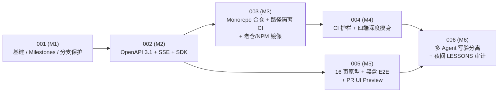

# Respire 体系化改造总路线图（OpenSpec 001–006）

> **冷启动入口**：刚接手任务的 AI Agent 请先读 **[AGENT_EXECUTION_GUIDE.md](AGENT_EXECUTION_GUIDE.md)**，然后运行 `node process/scripts/respire-process.mjs next` 自动选卡开工，**禁止自己乱挑任务**。

---

## 1. 六阶段依赖拓扑（`001` → `006`）

- **仓库现况**：`risense-ai/respire-resources` 与 `risense-ai/respire` 已上线并开启 `main` 分支保护（分别强制 `validate-openspec` 与 `ci-gate`）；`M1`–`M6` 里程碑、17 个流程标签及全部 **20 张 DAG 编排 Issue** 已在 GitHub 就绪。

---

## 2. OpenSpec Change 总览

| Change ID | 对应 Milestone | 核心目标 | 状态 |
| --- | --- | --- | --- |
| [001-resources-openspec-foundation](changes/001-resources-openspec-foundation/proposal.md) | `M1` | SSOT 仓库、OpenSpec 强约束、Milestones/Labels、分支保护、Project 同步脚本 | `proposed`（阶段一及 T01-06/08 已完） |
| [002-runtime-openapi-v1-migration](changes/002-runtime-openapi-v1-migration/proposal.md) | `M2` | 全域 `openapi.yaml`（REST+SSE）、SDK 生成链、旧 JSON-RPC 兼容与 Windows 插件迁移 | `proposed` |
| [003-monorepo-merge-and-release-bridge](changes/003-monorepo-merge-and-release-bridge/proposal.md) | `M3` | 过滤导入三仓至 `risense-ai/respire`（`T03-01` 已完）、路径隔离 CI、独立发版与老仓镜像 | `proposed`（`T03-01` 已完） |
| [004-ci-guardrails-and-code-slimming](changes/004-ci-guardrails-and-code-slimming/proposal.md) | `M4` | 依赖禁令/600 行棘轮/路由一致性护栏与 Core/Runtime/CLI/Client2 瘦身落地 | `proposed` |
| [005-prototypes-and-e2e-acceptance](changes/005-prototypes-and-e2e-acceptance/proposal.md) | `M5` | 16 页 HTML 原型、Mock API、Windows 专项 E2E 与 Client2 PR 自动录屏预览 | `proposed` |
| [006-multi-agent-automation-workflow](changes/006-multi-agent-automation-workflow/proposal.md) | `M6` | 六角色写验分离、`respire-process` 调度器、Bot Evidence 与夜间 `LESSONS.md` 审计 | `proposed`（角色规范与调度 MVP 已完） |

---

## 3. GitHub 编排卡片全量清单（20 张 Issue DAG）

| 卡片 ID | Milestone | GitHub Issue 引用 | 目标仓 | 前置依赖 | 摘要 |
| --- | --- | --- | --- | --- | --- |
| `CARD-001` | `M1` | [respire-resources#1](https://github.com/risense-ai/respire-resources/issues/1) | `respire-resources` | — | 授权并同步组织级 GitHub Project 看板（`needs:human`） |
| `CARD-002` | `M1` | [respire-resources#2](https://github.com/risense-ai/respire-resources/issues/2) | `respire-core` | — | 同步严格版 CodeRabbit 与 Issue/PR 模板至 `respire-core` |
| `CARD-003` | `M2` | [respire-resources#3](https://github.com/risense-ai/respire-resources/issues/3) | `respire-resources` | — | 补全 OpenAPI 3.1 细节、黄金 JSON 夹具与 `oasdiff` 门禁 |
| `CARD-004` | `M2` | [respire#1](https://github.com/risense-ai/respire/issues/1) | `respire` | `respire-resources#3` | 搭建 `sync-contracts` 与 Rust/Go/TS SDK 自动生成链 |
| `CARD-005` | `M3` | [respire#2](https://github.com/risense-ai/respire/issues/2) | `respire` | — | 冻结三老仓主分支写入并贴迁移公告（`needs:human`） |
| `CARD-006` | `M3` | [respire#3](https://github.com/risense-ai/respire/issues/3) | `respire` | `respire#2` | 过滤导入 `respire-runtime` 至 `apps/runtime` |
| `CARD-007` | `M3` | [respire#4](https://github.com/risense-ai/respire/issues/4) | `respire` | `respire#2` | 清洗 5.4 万行遗留服务端并导入 `respire-cli` 至 `apps/cli` |
| `CARD-008` | `M3` | [respire#5](https://github.com/risense-ai/respire/issues/5) | `respire` | `respire#2` | 导入 `respire-client2` 至 `apps/client2` 并验证三端路径隔离 `ci-gate` |
| `CARD-009` | `M3` | [respire#6](https://github.com/risense-ai/respire/issues/6) | `respire` | `respire#3,#4,#5` | 组件独立 Tag 发版、老仓/NPM Release Fan-Out 与双源更新器 |
| `CARD-010` | `M2` | [respire#7](https://github.com/risense-ai/respire/issues/7) | `respire` | `respire#1,#3` | Runtime 落地 OpenAPI 3.1 (`/v1/*`+SSE)、路由单测与冻结兼容层 |
| `CARD-011` | `M2` | [respire#8](https://github.com/risense-ai/respire/issues/8) | `respire` | `respire#4,#5,#7` | CLI/Client2/MCP 切消费生成 SDK、SSE 流与 Windows HTTP 插件通道 |
| `CARD-012` | `M4` | [respire#9](https://github.com/risense-ai/respire/issues/9) | `respire` | `respire#3,#4,#5` | 扩展 CI 护栏（600 行棘轮、`.unwrap()` 禁令、Core I/O 禁令） |
| `CARD-013` | `M4` | [respire-resources#4](https://github.com/risense-ai/respire-resources/issues/4) | `respire-core` | `respire#9` | `respire-core` 瘦身（删 2,511 行死代码 + `deepen_plan` O(N) 重写） |
| `CARD-014` | `M4` | [respire#10](https://github.com/risense-ai/respire/issues/10) | `respire` | `respire#7,#9` | `apps/runtime` 模型止血（1× SHA-256/非阻塞切换）与上帝文件解体 |
| `CARD-015` | `M4` | [respire#11](https://github.com/risense-ai/respire/issues/11) | `respire` | `respire#8,#9` | `apps/cli` 解除停服/`Paused` 锁并拆分巨型文件至 `<600` 行 |
| `CARD-016` | `M4` | [respire#12](https://github.com/risense-ai/respire/issues/12) | `respire` | `respire#8,#9` | `apps/client2` 删停服卸载/NPU/重状态机与 `go-sqlite3` 并合并前端状态 |
| `CARD-017` | `M5` | [respire-resources#5](https://github.com/risense-ai/respire-resources/issues/5) | `respire-resources` | `respire-resources#3` | 建设 16 页高保真 HTML 原型、Design Tokens 与 Mock Runtime 服务 |
| `CARD-018` | `M5` | [respire-resources#6](https://github.com/risense-ai/respire-resources/issues/6) | `respire-resources` | `respire-resources#5` | 建设黑盒 E2E 裁判库（含 Windows 100KB+ UTF-8 与 Playwright 双语） |
| `CARD-019` | `M5` | [respire#13](https://github.com/risense-ai/respire/issues/13) | `respire` | `respire#5`, `respire-resources#6` | 落地跨端 `e2e.yml` 与 Client2 PR 自动 UI Preview 录屏 |
| `CARD-020` | `M6` | [respire-resources#7](https://github.com/risense-ai/respire-resources/issues/7) | `respire-resources` | `respire#9,#13` | 完善 `respire-process` 单测、`evidence-register.yml` 与夜间 `LESSONS` 审计 |

---

## 4. 如何一键启动全自动推进

1. Maintainer 批准目标里程碑（例如先开放 `M1`–`M3`）：
   `node process/scripts/respire-process.mjs approve-milestone M1`
2. 任意外部 Agent 执行 `node process/scripts/respire-process.mjs next` 即可按 DAG 自动选出下一张未阻塞卡片推进。
