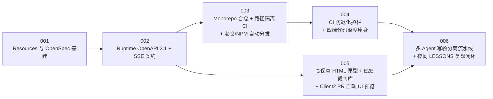

# Respire 体系化改造总路线图（OpenSpec 001–006）

> **原则**：先制定完整、可执行、可验证的 OpenSpec 规范，由 Maintainer（你）拍板后，再按阶段交给 AI Agent 在隔离 Worktree 中按图索骥实施，严禁边改边膨胀。

---

## 1. 为什么是 `001`–`006` 六个阶段？

此前 4 个仓库（`respire-core`、`respire-runtime`、`respire-cli`、`respire-client2`）各自演化，导致契约分裂、重复造轮子（非 vendor 代码达 33.3 万行）、Windows 命令行参数踩坑及 23 个冗余 CI Workflow。本次改造按 **先立规范与契约 → 再合仓建防线 → 最后落原型测试与全自动 Agent 闭环** 的依赖顺序拆分为 6 个 OpenSpec Change：

> **关于已存在的旧归档仓提醒（实施 `003` 前置处理）**：GitHub 检查确认 `risense-ai/respire` 当前已存在（为 2026-10-01 的私有归档历史快照）。进入 Change `003` 时，Maintainer 需先将其重命名为 `risense-ai/respire-legacy-202610`（或约定新的开源 Monorepo 名称），再创建新的公开 Monorepo。

---

## 2. OpenSpec Change 总览与当前状态

| 编号 | Change ID | 核心目标与交付物 | 前置依赖 | 当前状态 |
| --- | --- | --- | --- | --- |
| **01** | [001-resources-openspec-foundation](changes/001-resources-openspec-foundation/proposal.md) | 建立 `respire-resources` SSOT 结构、OpenSpec 准入流程、GitHub Project 看板规范、统一 `AGENTS.md` / `.coderabbit.yaml` 模板与结构校验器 | 无 | `proposed`（待批准） |
| **02** | [002-runtime-openapi-v1-migration](changes/002-runtime-openapi-v1-migration/proposal.md) | 制定 `openapi.yaml`（REST `/v1/*` + SSE `/v1/operations/{id}/events` + RFC 9457 错误）、Rust/Go/TS SDK 生成链、旧 JSON-RPC/`cli.exec` 兼容过渡层、Windows 插件替代方案 | `001` | `proposed`（待批准） |
| **03** | [003-monorepo-merge-and-release-bridge](changes/003-monorepo-merge-and-release-bridge/proposal.md) | 将 `runtime`/`cli`/`client2` 合入独立构建清单隔离的 Monorepo（过滤 CLI 5.4 万行僵尸服务端），落地路径路由 `ci-gate`、独立 Tag 发版及老仓库/NPM 自动镜像 | `001`, `002` | `proposed`（待批准） |
| **04** | [004-ci-guardrails-and-code-slimming](changes/004-ci-guardrails-and-code-slimming/proposal.md) | 将“禁跨端依赖 / 禁 SQLite / 600 行上限 / 路由一致性”固化为 CI 硬护栏，并在护栏下完成 Core/Runtime/CLI/Client2 瘦身落地 | `003` | `proposed`（待批准） |
| **05** | [005-prototypes-and-e2e-acceptance](changes/005-prototypes-and-e2e-acceptance/proposal.md) | 沉淀全页面高保真 HTML 原型与 Mock Runtime 夹具、建立语言无关黑盒 E2E（含 Windows 超长载荷专项）与 Client2 PR Playwright 自动录屏预览 | `002`, `003` | `proposed`（待批准） |
| **06** | [006-multi-agent-automation-workflow](changes/006-multi-agent-automation-workflow/proposal.md) | 落地 Implementer / 只读 Verifier / Triager / Scribe 六角色协同、`respire-process` 确定性选卡门禁、PR Evidence 注册及 `LESSONS.md` 夜间审计 | `004`, `005` | `proposed`（待批准） |

---

## 3. 每个 Change 的标准文件组成

每个 `openspec/changes/<change-id>/` 目录均包含 4 份强约束文件：
1. **`proposal.md`** — 改造动机（Why）、明确边界（Goals / Non-Goals）与验收标准；
2. **`design.md`** — 架构决策、向后兼容与过渡期策略、回滚预案；
3. **`tasks.md`** — 可勾选的原子施工任务清单（含所属模块与可执行验收命令）；
4. **`specs/<domain>/spec.md`** — 使用 `ADDED` / `MODIFIED` / `REMOVED` 与 `MUST` / `SHALL` / `GIVEN-WHEN-THEN` 编写的可验证行为契约。

---

## 4. 如何开始审批与逐步执行

1. **审阅与批准**：按 `001 → 006` 顺序审阅（推荐先批量审阅 `001`–`003` 打通地基，也可一次性审阅全部 6 份）；对任何细节有修改意见，直接在对应 `design.md` 或 `spec.md` 提出调整。
2. **逐阶段落地**：每批准一个 Change（状态标记为 `approved`），即触发 Implementer Agent 按 `tasks.md` 逐项施工，并由独立 Verifier Agent 对照 `specs/` 与 `test-cases/` 出具实证验收报告；验收通过后归档进 `openspec/specs/` 与 `openspec/changes/archive/`。
