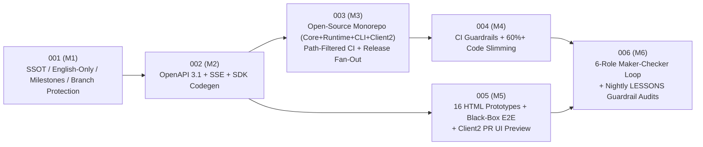

# Respire Transformation Master Roadmap (OpenSpec 001–006)

> **Cold-Start Entry**: Any incoming AI Agent MUST read **[AGENT_EXECUTION_GUIDE.md](AGENT_EXECUTION_GUIDE.md)** and **[FEATURE_LIFECYCLE.md](FEATURE_LIFECYCLE.md)** first, then run `node process/scripts/respire-process.mjs next` to claim the next unblocked task deterministically.

---

## 1. Six-Stage Dependency DAG (`001` -> `006`)

- **Current Status**: Both `risense-ai/respire-resources` and `risense-ai/respire` are live, public, published under **Respire Noncommercial License 1.0**, auto-merge enabled, and protected on `main` (`validate-openspec` / `ci-gate` + `verdict-gate`, with automated post-merge `evidence-register`). Org Project #1 ([Respire Transformation (001-006)](https://github.com/orgs/risense-ai/projects/1)), `M1`–`M6` Milestones, and 17 labels are in place. The workflow tracks **20 DAG-linked Issues** (`M1`–`M6` approved; `M1` archived; `CARD-001` and `CARD-002` closed; legacy freeze `CARD-005` deferred as `needs:human` until post-`-dev.1` cutover). The Core pre-publication audit is complete. Any later audited source import into `risense-ai/respire/apps/core/` follows **Respire Noncommercial License 1.0**, while legacy `risense-ai/respire-core` stays a private archive.

---

## 2. OpenSpec Change Summary

| Change | Milestone | Core Objective | Status |
| --- | --- | --- | --- |
| [001-resources-openspec-foundation](changes/archive/2026-11-23-001-resources-openspec-foundation/proposal.md) | `M1` | SSOT repo, Zero-CJK English-only gate, Milestones/Labels, branch protection, Project #1 sync | `archived`; see the [canonical governance spec](specs/governance/spec.md) |
| [002-runtime-openapi-v1-migration](changes/002-runtime-openapi-v1-migration/proposal.md) | `M2` | Full V1 `openapi.yaml` (REST+SSE), Rust/Go/TS SDKs, legacy JSON-RPC shim, Windows plugin migration | `approved` (`CARD-003` ready) |
| [003-monorepo-merge-and-release-bridge](changes/003-monorepo-merge-and-release-bridge/proposal.md) | `M3` | Import open-source `core`, `runtime`, filtered `cli`, `client2` into `risense-ai/respire`; path CI + Release Fan-Out | `approved` (`T03-01` done; `CARD-006`–`CARD-008` ready) |
| [004-ci-guardrails-and-code-slimming](changes/004-ci-guardrails-and-code-slimming/proposal.md) | `M4` | Hard CI guardrails (deps, Zero-CJK, 600-line ratchet, route parity) + 4-app slimming | `approved` |
| [005-prototypes-and-e2e-acceptance](changes/005-prototypes-and-e2e-acceptance/proposal.md) | `M5` | 16 HTML prototypes, Mock API, Windows & cross-app E2E suite, Playwright PR UI Preview | `approved` |
| [006-multi-agent-automation-workflow](changes/006-multi-agent-automation-workflow/proposal.md) | `M6` | Six-role separation, `respire-process` CLI, Bot Evidence registration, nightly `LESSONS.md` audits | `approved` (`T06-01`–`T06-05` promoted & done in `M1`) |

---

## 3. Live GitHub Issue DAG (20 Orchestration Cards)

| Card | Milestone | Issue Ref | Target Repo | Depends On | Summary |
| --- | --- | --- | --- | --- | --- |
| `CARD-001` | `M1` | [respire-resources#1](https://github.com/risense-ai/respire-resources/issues/1) | `respire-resources` | — | Authorize & sync org GitHub Project #1 (`DONE`) |
| `CARD-002` | `M1` | [respire-resources#2](https://github.com/risense-ai/respire-resources/issues/2) | `respire-core` | — | Pre-open-source audit of `respire-core` & sync templates (`DONE`) |
| `CARD-003` | `M2` | [respire-resources#3](https://github.com/risense-ai/respire-resources/issues/3) | `respire-resources` | — | Finalize OpenAPI 3.1 auth/error details, golden JSON fixtures & `oasdiff` gate |
| `CARD-004` | `M2` | [respire#1](https://github.com/risense-ai/respire/issues/1) | `respire` | `respire-resources#3` | Build `sync-contracts` & Rust/Go/TS SDK codegen pipeline |
| `CARD-005` | `M3` | [respire#2](https://github.com/risense-ai/respire/issues/2) | `respire` | — | Freeze legacy code repos (`runtime`/`cli`/`client2`) & publish migration notice (`needs:human`, deferred post-`-dev.1`) |
| `CARD-006` | `M3` | [respire#3](https://github.com/risense-ai/respire/issues/3) | `respire` | — | Import `respire-runtime` history into `apps/runtime` & wire `runtime-ci` |
| `CARD-007` | `M3` | [respire#4](https://github.com/risense-ai/respire/issues/4) | `respire` | — | Strip 54k legacy server lines & import `respire-cli` into `apps/cli` |
| `CARD-008` | `M3` | [respire#5](https://github.com/risense-ai/respire/issues/5) | `respire` | — | Import `respire-client2` into `apps/client2` & verify path-filtered `ci-gate` |
| `CARD-009` | `M3` | [respire#6](https://github.com/risense-ai/respire/issues/6) | `respire` | `respire#3,#4,#5` | Component Tag releases (`runtime-v*`/`cli-v*`/`client2-v*`), legacy/NPM Fan-Out & updater |
| `CARD-010` | `M2` | [respire#7](https://github.com/risense-ai/respire/issues/7) | `respire` | `respire#1,#3` | Implement OpenAPI 3.1 (`/v1/*`+SSE), route parity tests & `<200`-line legacy shim |
| `CARD-011` | `M2` | [respire#8](https://github.com/risense-ai/respire/issues/8) | `respire` | `respire#4,#5,#7` | Migrate CLI/Client2/MCP to generated SDKs, SSE & Windows HTTP plugin transport |
| `CARD-012` | `M4` | [respire#9](https://github.com/risense-ai/respire/issues/9) | `respire` | `respire#3,#4,#5` | Expand CI guardrails (600-line ratchet, `.unwrap()` ban, Core I/O ban, Zero-CJK) |
| `CARD-013` | `M4` | [respire-resources#4](https://github.com/risense-ai/respire-resources/issues/4) | `respire` | `respire-resources#2, respire#9` | Open-source `apps/core` import & slimming (remove 2,511 dead lines + O(N) `deepen_plan`) |
| `CARD-014` | `M4` | [respire#10](https://github.com/risense-ai/respire/issues/10) | `respire` | `respire#7,#9` | Slim `apps/runtime` (1x SHA-256, non-blocking switch, retire M3 lock, split god files) |
| `CARD-015` | `M4` | [respire#11](https://github.com/risense-ai/respire/issues/11) | `respire` | `respire#8,#9` | Slim `apps/cli` (remove stop/`Paused` gates, split giant files `<600` lines) |
| `CARD-016` | `M4` | [respire#12](https://github.com/risense-ai/respire/issues/12) | `respire` | `respire#8,#9` | Slim `apps/client2` (delete uninstall/NPU/52 host files, drop `go-sqlite3`, merge UI stores) |
| `CARD-017` | `M5` | [respire-resources#5](https://github.com/risense-ai/respire-resources/issues/5) | `respire-resources` | `respire-resources#3` | Build 16 HTML prototypes, shared `rem` tokens & Mock Runtime server |
| `CARD-018` | `M5` | [respire-resources#6](https://github.com/risense-ai/respire-resources/issues/6) | `respire-resources` | `respire-resources#5` | Build black-box E2E suite (Windows 100KB+ UTF-8 & Playwright `en`/`zh` tests) |
| `CARD-019` | `M5` | [respire#13](https://github.com/risense-ai/respire/issues/13) | `respire` | `respire#5`, `respire-resources#6` | Deploy cross-platform `e2e.yml` & Client2 PR automated Playwright UI Preview |
| `CARD-020` | `M6` | [respire-resources#7](https://github.com/risense-ai/respire-resources/issues/7) | `respire-resources` | `respire#9,#13` | Add `respire-process` tests, `evidence-register.yml` & nightly `LESSONS.md` audits |

---

## 4. Activating Autonomous Agent Execution

1. Maintainer approves target Milestones (`M1`–`M6`):
   `node process/scripts/respire-process.mjs approve-milestone M1`
2. Any external Agent runs `node process/scripts/respire-process.mjs next` to automatically pick, claim, and execute the next unblocked Issue.
