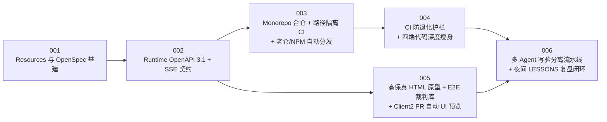

# Respire 体系化改造总路线图（OpenSpec 001–006）

> **冷启动入口**：刚接手任务的其他 AI Agent，请先阅读 **[AGENT_EXECUTION_GUIDE.md](AGENT_EXECUTION_GUIDE.md)** 与 **[../process/roles/README.md](../process/roles/README.md)**。  
> **原则**：先定规范与契约，由 Maintainer（你）拍板后，再交给独立 Worktree 内的 Agent 按 `tasks.md` 逐步执行，并由独立只读 Verifier 验收。

---

## 1. 六阶段依赖拓扑（`001` → `006`）

> **仓库拓扑进展（2026-11-24）**：原归档私有仓已更名为 `risense-ai/respire-back`；新的公开 Monorepo **`risense-ai/respire`** 与规范中枢 **`risense-ai/respire-resources`** 均已创建上线（`T03-01` 完成）。当前各仓代码在 `003` 正式导入前仍以三大源仓为历史快照，严禁在源仓开启无契约新功能。

---

## 2. OpenSpec Change 总览与当前进度

| 编号 | Change ID | 核心目标与交付物 | 前置依赖 | 当前状态 |
| --- | --- | --- | --- | --- |
| **01** | [001-resources-openspec-foundation](changes/001-resources-openspec-foundation/proposal.md) | SSOT 仓库结构、OpenSpec 强约束、GitHub Project 看板与统一模板（阶段一已完成，待阶段二看板配置） | 无 | `proposed`（待批准推进阶段二） |
| **02** | [002-runtime-openapi-v1-migration](changes/002-runtime-openapi-v1-migration/proposal.md) | V1 全域 `openapi.yaml`（REST + SSE）、SDK 生成链、旧 JSON-RPC 映射与 Windows 插件迁移 | `001` | `proposed`（待批准） |
| **03** | [003-monorepo-merge-and-release-bridge](changes/003-monorepo-merge-and-release-bridge/proposal.md) | 过滤历史导进 `risense-ai/respire`（`T03-01` 已建仓）、路径路由 `ci-gate`、独立 Tag 与老仓/NPM 镜像 | `001`, `002` | `proposed`（`T03-01` 已完成） |
| **04** | [004-ci-guardrails-and-code-slimming](changes/004-ci-guardrails-and-code-slimming/proposal.md) | CI 防退化护栏（禁依赖/600 行棘轮/路由一致性）与 Core/Runtime/CLI/Client2 瘦身落地 | `003` | `proposed`（待批准） |
| **05** | [005-prototypes-and-e2e-acceptance](changes/005-prototypes-and-e2e-acceptance/proposal.md) | 16 页高保真 HTML 原型、Mock API、黑盒 E2E（含 Windows 专项）与 Client2 PR 自动录屏预览 | `002`, `003` | `proposed`（待批准） |
| **06** | [006-multi-agent-automation-workflow](changes/006-multi-agent-automation-workflow/proposal.md) | 六角色写验分离、`respire-process.mjs` 确定性选卡门禁与 `LESSONS.md` 夜间复盘 | `004`, `005` | `proposed`（角色规范已就绪） |

---

## 3. 每个 Change 的标准组成与推进方式

1. **`proposal.md`**（Why / Goals / Non-Goals）→ **`design.md`**（架构与兼容过渡）→ **`tasks.md`**（可勾选原子步骤）→ **`specs/<domain>/spec.md`**（`MUST`/`SHALL` + `GIVEN/WHEN/THEN`）。
2. 其他 Agent 接手时，直接参照 [AGENT_EXECUTION_GUIDE.md](AGENT_EXECUTION_GUIDE.md) 中的**阶段派单提示词**即可逐项施工并移交独立只读 Verifier 验收。
