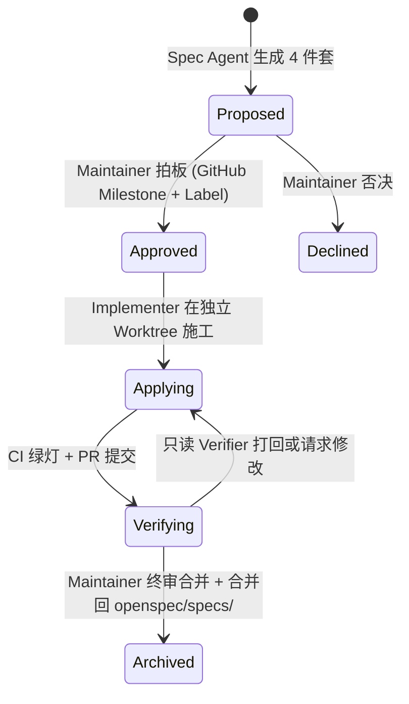

# Design: 001-resources-openspec-foundation

## 1. SSOT 仓库定位与引用机制

`risense-ai/respire-resources` 对所有研发仓保持**上游只读真相源**关系：

- 任何代码仓（闭源 `respire-core`、开源 Monorepo `respire`）不得私自维护第二套全局规范或重复契约副本。
- `respire` 与 `respire-core` 通过固定版本引用脚本同步 `contracts/` 的锁定快照（记录来源 commit SHA），避免 CI 运行期出现不确定漂移。
- 各代码仓根目录保留精简版 `AGENTS.md`，首行显式声明继承 `respire-resources/AGENTS.md` 全局宪法，只补充本仓本地构建、工具链和特殊例外。

## 2. OpenSpec 状态机与强约束闸门

- **闸门 1（准入前）**：无 `approved` 状态 Change，禁止 Implementer 建分支改代码；紧急 hotfix 必须在 24 小时内补齐事后 Change 记录与 `LESSONS.md` 条目。
- **闸门 2（Issue 强制元数据）**：GitHub Issue 模板要求提供 `Change ID`、`关联 Spec §`、`关联原型路径`、`前置依赖 Issue`、`对应 E2E 用例 ID`；缺项则由 Triager 打回补充，不排入开发队列。

## 3. 统一审查与文档防膨胀机制

- **`.coderabbit.yaml` 模板升级**：统一淘汰当前 `core`/`cli` 中过时的 `chill` 与无效路径过滤，在 `process/templates/coderabbit.yaml` 按目录声明强约束（Rust 禁 `.unwrap()` / 重复 SHA-256；Go 禁 `sqlite3` / goroutine 泄漏；Workflow 禁未钉版 Action / 过度权限；OpenSpec 禁超 400 行与无 Scenario 需求）。
- **单文件行数校验**：文档校验脚本对 `openspec/` 下所有 Markdown 强制执行 `<= 400` 行上限，倒逼设计拆章，防止出现无法阅读的巨型规格书。
- **零外部依赖校验器**：`validate-openspec.mjs` 仅使用 Node 内置模块，确保在任何本地环境与 GitHub Hosted Runner 上无需 `npm install` 即可秒级校验。

## 4. Risks & Rollback

- **风险**：流程过重可能拖慢微小改动（如改 typo 或单行 bugfix）。
- **缓解**：允许“轻量 bugfix”仅关联已有 Spec 节号与回归测试记录，无需新建整套 Proposal；仅新功能、跨模块重构、接口变更、UI 改版强制走完整 OpenSpec Change。
- **回滚**：本 Change 仅作用于新建的 `respire-resources` 仓及文档治理规范，不改动既有生产代码，可随时调整模板而零线上风险。
