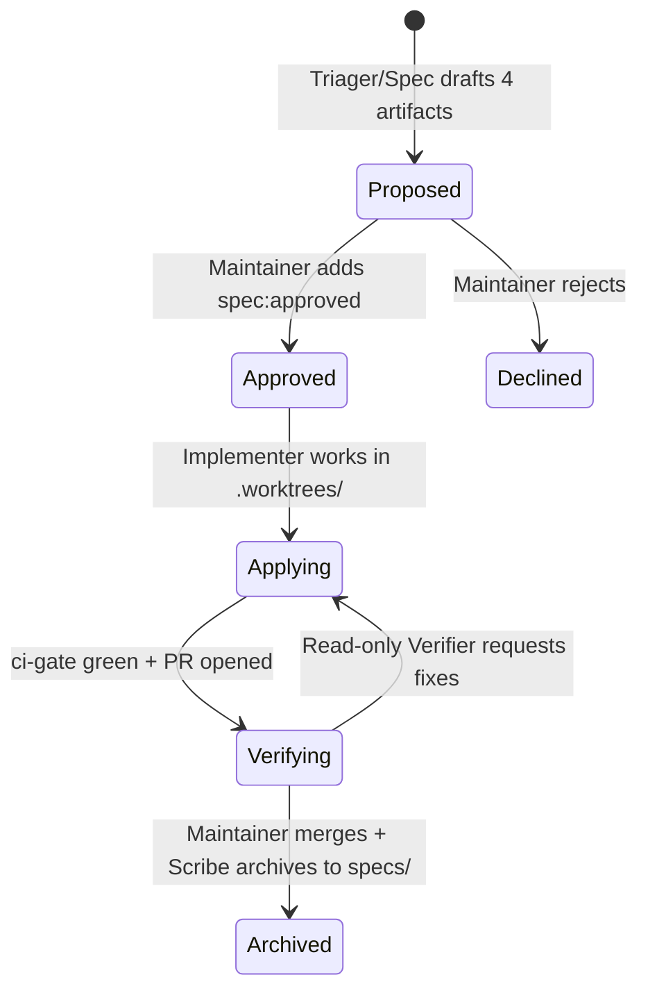

# Design: 001-resources-openspec-foundation

## 1. SSOT Architecture & Upstream Synchronization

`risense-ai/respire-resources` acts as the authoritative upstream reference:

- Code repositories MUST NOT maintain divergent copies of global policies or hand-edited API contracts.
- `risense-ai/respire` pins exact synced contract snapshots in `contracts/sync.lock.json` (commit SHA + SHA-256 checksum).
- Monorepo `AGENTS.md` inherits `respire-resources/AGENTS.md` and only adds repository-specific build and guardrail rules.

## 2. OpenSpec Gate State Machine

- **Gate 1 (Entry)**: Implementers MUST NOT write product code unless the Change and GitHub Issue carry `spec:approved`. Emergency `hotfix/` PRs require retroactive OpenSpec + `LESSONS.md` records within 24 hours.
- **Gate 2 (Traceable Metadata)**: Every scheduled Issue MUST carry `<!-- respire-card ... -->` metadata (`id`, `change`, `milestone`, `target_repo`, `depends_on`) and map to OpenSpec `tasks.md` items.

## 3. English-Only Enforcement & Doc Caps

- `process/scripts/validate-openspec.mjs` scans every text file in `respire-resources` (excluding `.git`, `node_modules`, and explicit UI i18n fixture paths) for CJK code points (`\u3000-\u303F`, `\u3400-\u4DBF`, `\u4E00-\u9FFF`, `\uF900-\uFAFF`, `\uFF00-\uFFEF`) and fails with exact `file:line` diagnostics on any hit.
- Non-archive `.md` files under `openspec/` MUST NOT exceed **400 lines**.
- `process/templates/coderabbit.yaml` configures `language: en-US`, `profile: assertive`, `request_changes_workflow: true`, and path-specific rules for `apps/core`, `apps/runtime`, `apps/cli`, `apps/client2`, `openspec`, and `.github/workflows`.

## 4. GitHub Milestones, Project & Branch Protection

- **Milestones & Labels**: `M1`–`M6` align 1:1 with OpenSpec `001`–`006` across `respire-resources` and `respire`.
- **Org Project v2 Sync**: `process/scripts/sync-project-board.mjs` creates/updates `"Respire Transformation (001-006)"` idempotently once the Maintainer grants `project,read:project` via `gh auth refresh -s project,read:project`.
- **Branch Protection**: `respire-resources` `main` requires `validate-openspec` (`strict: true`); `respire` `main` requires `ci-gate` (`strict: true`).

## 5. Risks & Rollback

- **Risk**: Heavy governance slows one-line typo or trivial doc fixes.
- **Mitigation**: Trivial bugfixes may reference existing canonical specs without creating a new Change directory; architectural/contract/UI changes always require a Change.
- **Rollback**: Changes here govern workflow metadata and CI checks without altering runtime binaries.
