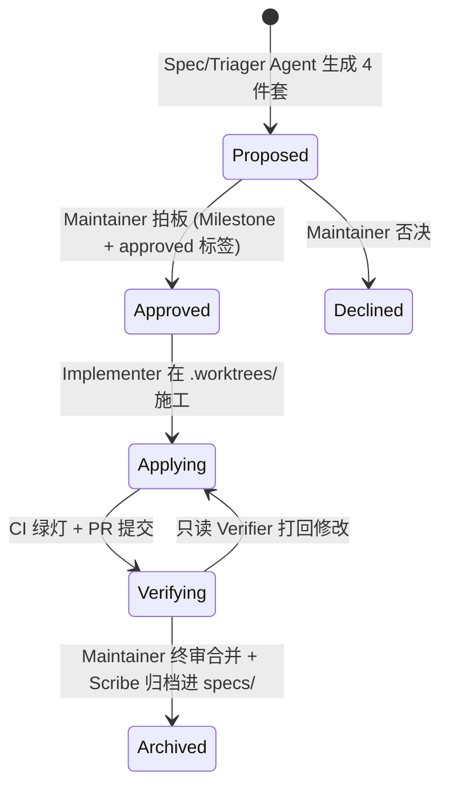

# Design: 001-resources-openspec-foundation

## 1. SSOT 仓库定位与引用机制

`risense-ai/respire-resources` 对所有研发仓保持**上游只读真相源**关系：

- 任何代码仓（闭源 `respire-core`、开源 Monorepo `risense-ai/respire`）不得私自维护第二套全局规范或重复契约副本。
- `respire` 通过 `contracts/sync.lock.json` 锁定引用的 `respire-resources` commit SHA 与 `openapi.yaml` 校验和，确保构建可 100% 复现。
- 各代码仓根目录保留精简版 `AGENTS.md`，首行声明继承 `respire-resources/AGENTS.md`，只补充本仓本地命令与特殊边界。

## 2. OpenSpec 状态机与强约束闸门



- **闸门 1（准入前）**：无 `approved` 状态 Change，禁止 Implementer 建分支改代码；紧急 `hotfix/` 必须在 24 小时内补齐事后 Change 与 `LESSONS.md` 条目。
- **闸门 2（Issue 强制元数据）**：GitHub Issue 模板要求提供 `Change ID`、`关联 Spec §`、`关联原型路径`、`前置依赖 Issue`、`对应 E2E 用例 ID`；缺项则由 Triager 打 `needs-info` 标签，不排入可开发队列。

## 3. GitHub 看板、Milestone 与分支保护标准命令

Agent 在阶段二执行 `T01-05`–`T01-08` 时直接按以下标准配置操作：

```sh
# 1. 创建组织级 Project 看板（需 gh auth refresh -s project 权限）
gh project create --owner risense-ai --title "Respire Engineering"

# 2. 为 respire 与 respire-resources 建立一致 Milestone
for repo in risense-ai/respire-resources risense-ai/respire; do
  for m in M1-OpenAPI-Migration M2-Monorepo-Merge M3-Guardrails-Slimming M4-E2E-And-Automation; do
    gh api -X POST "repos/$repo/milestones" -f title="$m"
  done
done

# 3. 为 respire-resources 开启 main 分支保护（要求 validate-openspec 通过）
gh api -X PUT "repos/risense-ai/respire-resources/branches/main/protection" \
  --input - <<'JSON'
{
  "required_status_checks": { "strict": true, "contexts": ["validate-openspec"] },
  "enforce_admins": false,
  "required_pull_request_reviews": null,
  "restrictions": null
}
JSON
```

## 4. 统一审查与文档防膨胀机制

- **`.coderabbit.yaml` 模板升级**：以 `process/templates/coderabbit.yaml` 为唯一标准模板（`assertive` + 路径红线），淘汰旧仓过时的 `chill` 配置。
- **单文件行数与零依赖校验**：`process/scripts/validate-openspec.mjs` 仅用 Node 内置模块校验 `openspec/` 下非归档 Markdown `<= 400` 行及 OpenAPI 3.1 结构。

## 5. Risks & Rollback

- **风险**：流程过重可能拖慢微小改动（如单行 typo 或简单修复）。
- **缓解**：允许“轻量 bugfix”仅关联已有 Spec `§` 与回归测试记录，无需新建整套 Proposal；新功能、跨模块重构、接口变更、UI 改版强制走完整 OpenSpec Change。
- **回滚**：本 Change 仅作用于治理规范与 GitHub 元数据配置，不影响既有生产代码与发布链。
